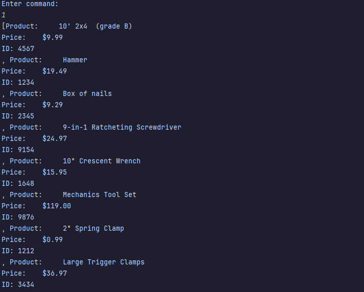

# Search Inventory App

A command-line app that reads the whole inventory of products and adds products by using
command numbers to select the different options in the menu.

## Features

- List all the products available.
- Lookup for a specific product that's in the list. 
- Does a comparison of prices between products. 
- Adds new products to the list.
- Every line is numbered.

## How to run it

1. Open IntelliJ
2. Run `InventoryApp.java`
3. Type a number and select one of the options of the menu.
4. Type number 5 to quit the application.

## Interesting Code

```java
private static ArrayList<Product> loadInventory() {
        ArrayList<Product> inventory = new ArrayList<>();
        try {
            FileReader fileReader = new FileReader("inventory.csv");
            BufferedReader bufferedReader = new BufferedReader(fileReader);

            // read a line into line, then check it isn't null, all in one step
            String line;

            while ((line = bufferedReader.readLine()) != null) {
                //Split it into individual fields using the | character as the delimiter
                String[] fields = line.split(Pattern.quote("|"));

                //fill data into employee object and add to list
                int id = Integer.parseInt(fields[0]);
                String name = fields[1];
                double price = Double.parseDouble(fields[2]);
                Product product = new Product(id, name, price);
                inventory.add(product);
            }

            bufferedReader.close();
        } catch (IOException e) {
            System.out.println("There was an error reading the product file. Check the location of the file.");
        }
        return inventory;
    }
```
This code shows how to read a file.

## Screenshot
